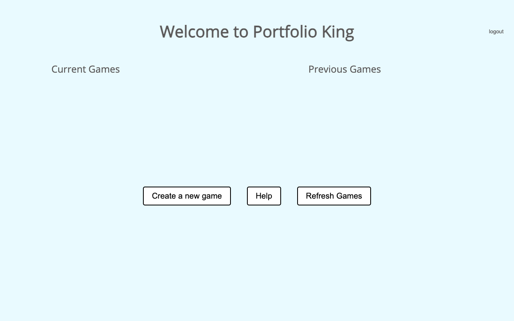
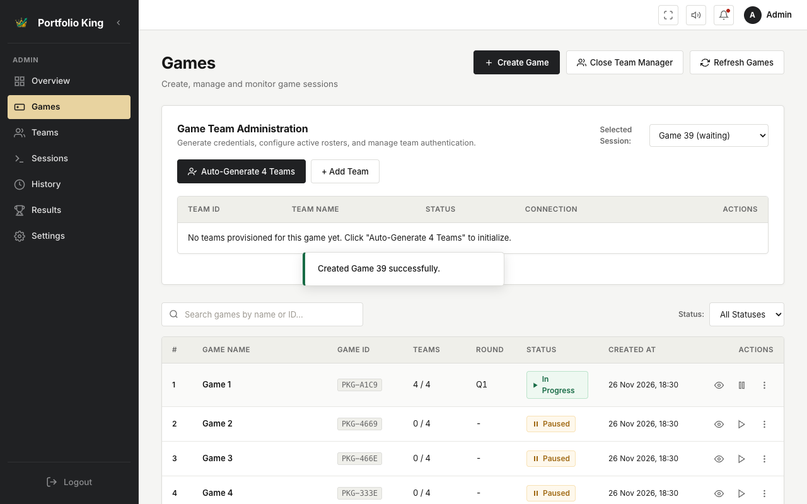
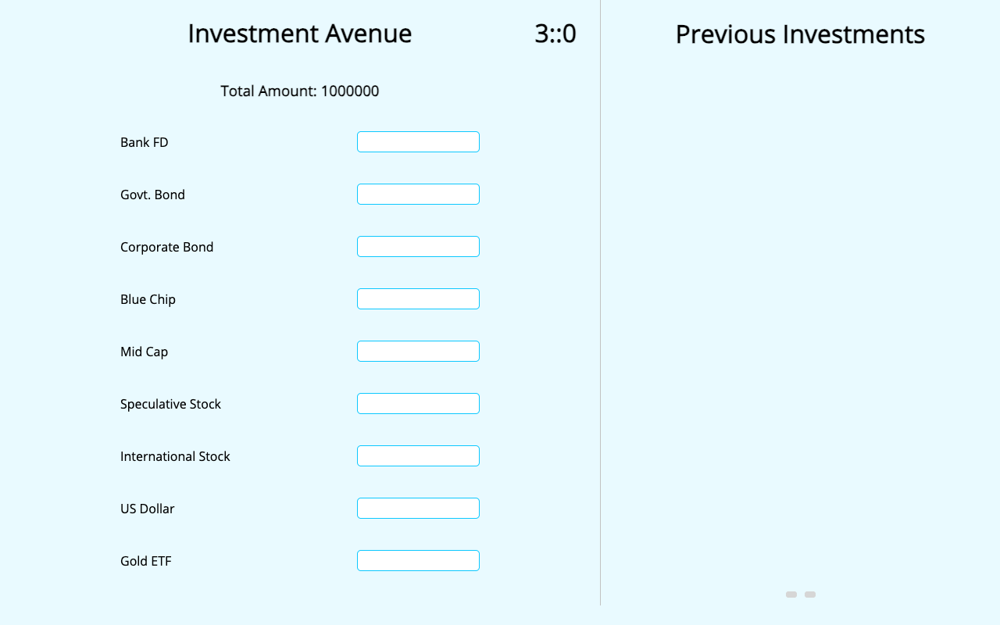
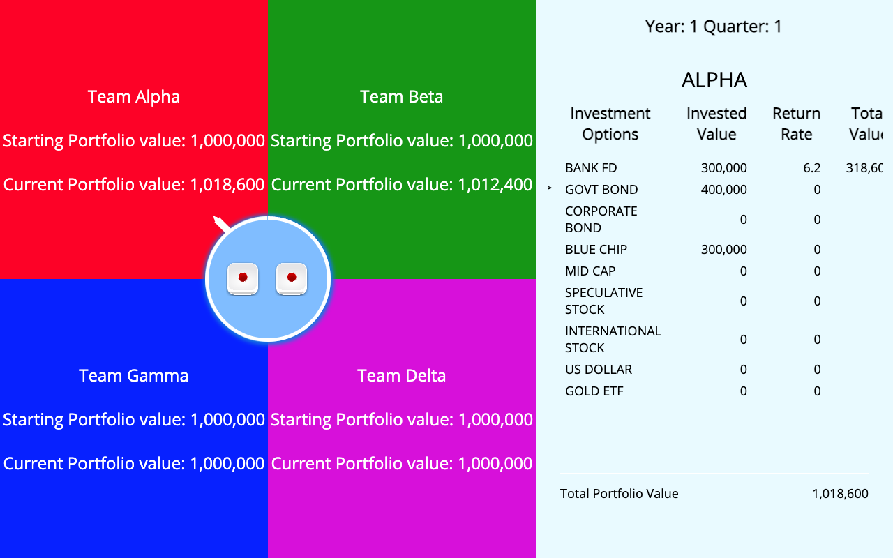
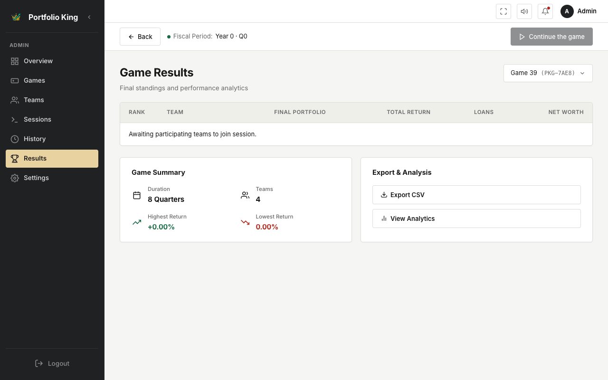
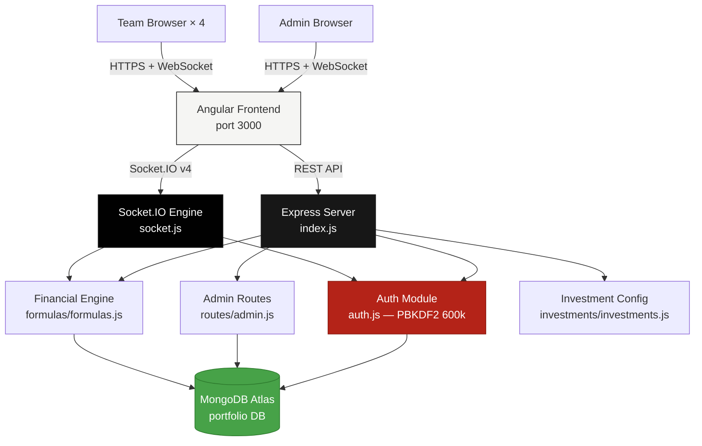

<div align="center">


# Portfolio King

**Real-Time Multiplayer Financial Strategy Simulation**

Portfolio King is an interactive investment simulation platform built for finance competitions, business schools, and investment workshops. Teams compete in real time — allocating portfolios, managing loans, navigating market volatility, and tracking performance round by round.

<br/>

[](https://portfolio-king-043i.onrender.com/login)
[](https://angular.io)
[](https://www.typescriptlang.org)
[](https://nodejs.org)
[](https://expressjs.com)
[](https://www.mongodb.com)
[](https://socket.io)
[](https://render.com)

<br/>

[Live Demo](https://portfolio-king-043i.onrender.com/login) · [Features](#-features) · [Screenshots](#-screenshots) · [Getting Started](#-getting-started) · [Architecture](#-architecture) · [Deployment](#-deployment)

</div>

---

## 🎯 Overview

Portfolio King simulates a structured investment competition over multiple rounds. An administrator creates and manages games while teams compete to grow their portfolios through strategic allocation across equities, debt, gold, and real estate.

Each round, a dice roll determines market conditions — amplifying or dampening returns. Teams handle EMI obligations, can opt into a Fund of Funds layer, take loans when needed, and track their net worth in real time against the leaderboard.

The platform is designed for classroom use, finance workshops, and corporate training events, where up to four teams can compete simultaneously from separate devices.

---

## ✨ Features

<table>
<tr>
<td width="50%">

**🎮 Real-Time Gameplay**
- WebSocket-powered multiplayer (Socket.IO v4)
- Synchronized game state across all connected teams
- Live market impact notifications per round
- Dice-based market condition simulation

**👤 Administrator Dashboard**
- Create, rename, duplicate, and archive games
- Auto-generate team credentials
- Monitor active sessions and round progress
- Export results to CSV
- End game and publish final standings

**🔐 Secure Authentication**
- PBKDF2-HMAC-SHA256 (600,000 iterations)
- Duplicate session prevention
- Server-side route authorization
- Production credential guard on startup

</td>
<td width="50%">

**💼 Investment Portfolio**
- Six asset classes: Equity (Large/Mid/Small Cap), Debt–Corporate, Gold, Real Estate
- Risk ratings and expected return ranges per avenue
- Round-by-round allocation with reset capability
- FOF (Fund of Funds) with 2% management fee
- Loan management with EMI calculations

**📊 Financial Engine**
- PMT / PPMT / IPMT calculations (Excel-compatible)
- 6.2% Bank FD baseline rate
- Real-time net worth tracking
- Final leaderboard ranked by portfolio value
- CSV export with per-team analytics

**📱 Responsive Interface**
- Works on desktop, tablet, and mobile
- Warm ivory and charcoal design system
- Lottie loading animation

</td>
</tr>
</table>

---

## 📸 Screenshots

<table>
<tr>
<td width="50%" align="center">

**Login Interface**


</td>
<td width="50%" align="center">

**Admin Game Dashboard**


</td>
</tr>
<tr>
<td width="50%" align="center">

**Team Manager**


</td>
<td width="50%" align="center">

**Player Investment Workspace**


</td>
</tr>
<tr>
<td width="50%" align="center">

**Active Game Board**


</td>
<td width="50%" align="center">

**Multiplayer Round in Progress**


</td>
</tr>
</table>

---

## 🏗 Architecture



**Request flow:**
- The Angular SPA is served as a static build from `dist/Client/` by Express
- REST endpoints handle authentication, game management, and admin operations
- Socket.IO events handle real-time game synchronization: `join-game`, `player-ready`, `dice-rolled`, `submit-investment`, `game-ended`
- All socket events are verified server-side before processing

---

## 🎲 How the Game Works

| Step | Action |
|------|--------|
| 1 | Administrator logs in and creates a new game, specifying the number of rounds |
| 2 | Teams are auto-generated with credentials — shared with participants |
| 3 | Teams log in and join the waiting room |
| 4 | Once all teams are ready, the admin starts the round |
| 5 | Each team allocates their investment budget (₹5,00,000 starting capital) across six asset classes |
| 6 | Admin rolls the dice — the result (1–6) applies a market multiplier to all returns |
| 7 | Returns are calculated using PMT/PPMT/IPMT formulas; loans deduct EMI amounts |
| 8 | Net worth updates in real time for all players |
| 9 | Rounds repeat until the configured end (maximum 8 quarters) |
| 10 | Final leaderboard ranks teams by portfolio value minus outstanding loans |

**Investment avenues and expected return ranges:**

| Avenue | Risk | Expected Return |
|--------|------|----------------|
| Equity – Large Cap | ●●○○○ | 8% – 14% |
| Equity – Mid Cap | ●●●○○ | 10% – 18% |
| Equity – Small Cap | ●●●●○ | 12% – 24% |
| Debt – Corporate | ●●○○○ | 6% – 10% |
| Gold | ●●○○○ | 5% – 9% |
| Real Estate (REIT) | ●●●○○ | 7% – 12% |

> **Fund of Funds:** An optional allocation tier with a 2% management fee applied before returns.  
> **Bank FD baseline:** 6.2% guaranteed rate used as a floor comparison metric.

---

## 🚀 Getting Started

### Prerequisites

- **Node.js** `≥ 18.0.0` (tested on 18.x LTS and 20.x LTS)
- **npm** `≥ 9`
- **MongoDB** — local instance (`mongod`) or a free [MongoDB Atlas](https://www.mongodb.com/atlas) cluster

### Installation

```bash
# 1. Clone the repository
git clone https://github.com/dr5t/Portfolio-King.git
cd Portfolio-King

# 2. Install all dependencies (root + backend + frontend)
npm run build
```

> `npm run build` installs backend and frontend dependencies then compiles the Angular app into `portfolio-king/dist/Client/`.

### Environment Configuration

Create a `.env` file in `portfolio-king-server/` using the provided example:

```bash
cp portfolio-king-server/.env.example portfolio-king-server/.env
```

Edit the values:

```env
PORT=3000
HOST=0.0.0.0
MONGODB_URI=mongodb://127.0.0.1:27017/portfolio
DB_NAME=portfolio
ADMIN_USERNAME=admin
ADMIN_PASSWORD=your_secure_password_here
```

> **Never commit your `.env` file.** It is listed in `.gitignore`.

### Start the Application

```bash
# Production mode (serves the compiled Angular build)
npm start

# Application available at:
# http://localhost:3000
```

For development, build the Angular app with watch mode from a separate terminal:

```bash
cd portfolio-king
NODE_OPTIONS="--openssl-legacy-provider" npx ng build --watch
```

---

## ⚙️ Environment Variables

| Variable | Purpose | Required |
|----------|---------|----------|
| `PORT` | Server listening port | No (default: `3000`) |
| `HOST` | Bind address | No (default: `0.0.0.0`) |
| `MONGODB_URI` | MongoDB connection string | **Yes** |
| `DB_NAME` | Database name | No (default: `portfolio`) |
| `ADMIN_USERNAME` | Administrator login username | **Yes** |
| `ADMIN_PASSWORD` | Administrator login password | **Yes** |

A safe `.env.example` template is included in both the root and `portfolio-king-server/` directories.

---

## 📁 Project Structure

```
Portfolio-King/
├── package.json                  # Root scripts: build & start
├── render.yaml                   # Render deployment config
├── .env.example                  # Safe environment template
├── docs/
│   ├── logo-transparent.png      # Brand logo
│   └── screenshots/              # README screenshots
│
├── portfolio-king/               # Angular frontend
│   ├── src/
│   │   ├── app/
│   │   │   ├── login/            # Login component (team + admin)
│   │   │   ├── home/             # Admin dashboard
│   │   │   ├── game/             # Game board component
│   │   │   ├── investment-avenue/ # Player investment UI
│   │   │   ├── game-status/      # Round status display
│   │   │   ├── rules/            # Game rules component
│   │   │   └── services/         # Portfolio, auth, utility services
│   │   ├── assets/
│   │   │   ├── imgs/             # Logo, bull-bear illustration, dice
│   │   │   ├── fonts/            # Custom typography
│   │   │   └── loading-animation.json  # Lottie animation
│   │   └── styles.scss           # Global design tokens and styles
│   └── angular.json
│
└── portfolio-king-server/        # Express backend
    ├── index.js                  # Server entry point, HTTP + Socket.IO init
    ├── auth.js                   # PBKDF2 password hashing & verification
    ├── socket.js                 # Socket.IO event handlers
    ├── routes/
    │   └── admin.js              # Admin REST API routes
    ├── formulas/
    │   └── formulas.js           # PMT/PPMT/IPMT financial calculations
    ├── investments/
    │   └── investments.js        # Asset class configuration
    └── db/
        └── portfolio_db.js       # MongoDB connection and queries
```

---

## ☁️ Deployment

Portfolio King is deployed on [Render](https://render.com) using the included `render.yaml`.

### Render Setup

1. **Connect your repository** to Render from the dashboard
2. Render detects `render.yaml` automatically and configures the service

**Build command:**
```
npm run build
```

**Start command:**
```
npm start
```

**Required environment variables** (set in Render dashboard — do not commit):

| Variable | Value |
|----------|-------|
| `MONGODB_URI` | Your MongoDB Atlas connection string |
| `ADMIN_PASSWORD` | A secure password for the admin account |
| `NODE_VERSION` | `18.20.8` |

### MongoDB Atlas

1. Create a free cluster at [mongodb.com/atlas](https://www.mongodb.com/atlas)
2. Add a database user with read/write permissions
3. Under **Network Access**, add `0.0.0.0/0` (allow from anywhere) for Render's dynamic IPs
4. Copy the connection string into `MONGODB_URI`

### Live Application

> **[https://portfolio-king-043i.onrender.com/login](https://portfolio-king-043i.onrender.com/login)**

> **Note:** The free Render plan spins down instances after inactivity. The first request after a cold start may take 30–60 seconds while the server wakes up. Subsequent requests are fast.

---

## 🧪 Testing

The project includes automated test scripts in the `scratch/` directory. Run them from the project root:

```bash
# Financial calculation regression tests
node scratch/test-financial-calculations.js

# Authentication and authorization unit tests
node scratch/test-auth-system.js

# 4-team multiplayer end-to-end test (requires Puppeteer)
node scratch/run-e2e-auth-multiplayer.js

# Responsive viewport tests (requires Puppeteer)
node scratch/test-viewports-responsiveness.js

# Lottie loading animation verification (requires Puppeteer)
node scratch/test-loader-lottie.js
```

**Puppeteer dependency:** Tests use the globally installed Puppeteer and system Chrome. Ensure Chrome is installed at `/Applications/Google Chrome.app/` on macOS.

---

## 🔒 Security

- **Password hashing:** PBKDF2-HMAC-SHA256 with 600,000 iterations and cryptographically random salts. Existing hashes are automatically migrated on first login.
- **Session management:** Each team credential may only have one active session. Duplicate logins are rejected with a clear error.
- **Server-side authorization:** All admin REST routes and all socket events are validated on the server before processing. The client is never trusted for game-state decisions.
- **HTTP security headers:** Content-Security-Policy, HSTS, X-Frame-Options, and X-Content-Type-Options applied via Express middleware.
- **Environment secrets:** No credentials in source code. All secrets loaded from environment variables at runtime.
- **Production guard:** The server refuses to start if `ADMIN_USERNAME` or `ADMIN_PASSWORD` are unset in production.
- **Dependency audits:** Backend dependencies maintained at zero high/critical vulnerabilities. Run `npm audit` in `portfolio-king-server/` to verify.

---

## 🤝 Contributing

This is a private project. If you have been granted access and would like to contribute:

1. Create a feature branch from `main`
2. Make focused, well-described commits
3. Test all changes with the existing test suite before opening a pull request
4. Do not modify financial formulas, authentication logic, or the approved visual design without prior discussion

---

## 📄 License & Credits

**Author:** Shaurya Tiwari  
**Repository:** [github.com/dr5t/Portfolio-King](https://github.com/dr5t/Portfolio-King)

**Third-party assets:**
- [Lottie Web](https://github.com/airbnb/lottie-web) — MIT License — loading animation renderer
- [Socket.IO](https://socket.io) — MIT License — real-time communication
- [ngx-owl-carousel-o](https://github.com/vitalii-andriiovskyi/ngx-owl-carousel-o) — MIT License — carousel component
- Loading animation © original creator — used with permission

---

<div align="center">


**Portfolio King** — Financial Strategy Simulation

[Live Demo](https://portfolio-king-043i.onrender.com/login) · [GitHub](https://github.com/dr5t/Portfolio-King)

</div>
