<div align="center">

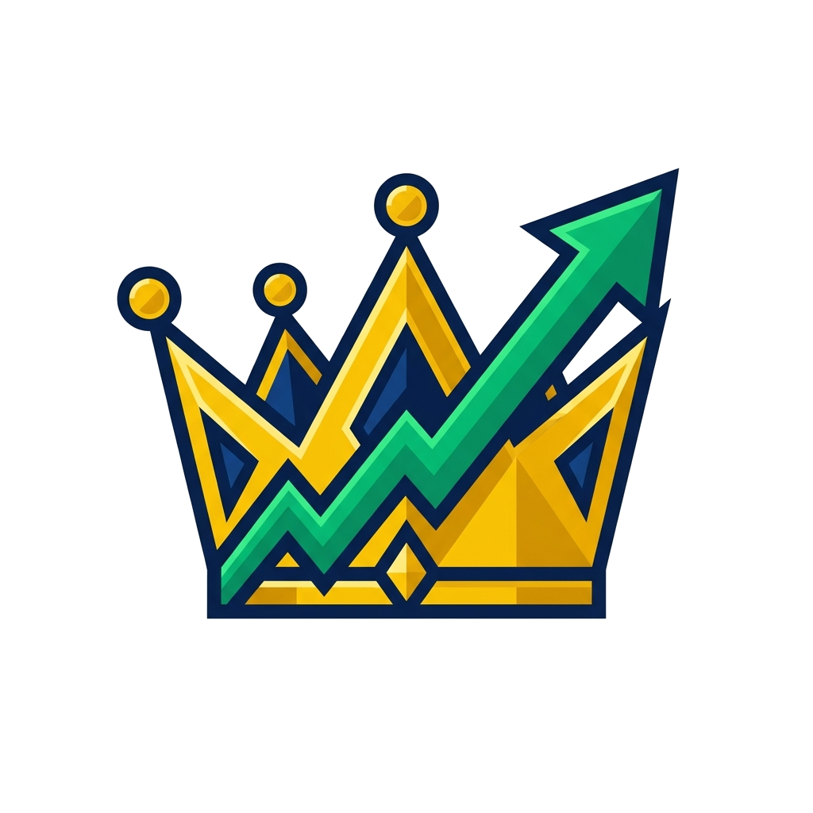

# Portfolio King

### Real-Time Multiplayer Financial Strategy Simulation

[](https://angular.dev)
[](https://www.typescriptlang.org)
[](https://nodejs.org)
[](https://www.mongodb.com)
[](https://socket.io)
[](https://render.com)
[](LICENSE)

<p align="center">
  <strong>Build portfolios. Manage risk. Compete in dynamic financial markets.</strong>
</p>

<a href="https://portfolio-king-043i.onrender.com/login">
  
</a>

<br/><br/>

[Features](#features) · [Screenshots](#screenshots) · [Installation](#installation) · [Architecture](#architecture)

</div>

---

<a id="project-overview"></a>
##  Project Overview

**Portfolio King** is a turn-based multiplayer financial simulation engineered for business schools, corporate treasury training, investment clubs, and university competitions.

Up to four teams (institutional syndicates) compete simultaneously from separate devices in an eight-quarter market simulation. Each quarter presents a distinct macroeconomic climate determined by dice mechanics — influencing asset volatility, corporate debt yields, equity performance, and liquidity constraints.

The platform has been modernized with an institutional-grade user interface, responsive layout architecture, Lottie loading animations, and comprehensive administration tools while strictly preserving the verified core financial calculation engine, Excel-compatible loan formulas, and game dynamics.

---

<a id="screenshots"></a>
<a id="application-preview"></a>
##  Application Preview

<div align="center">
  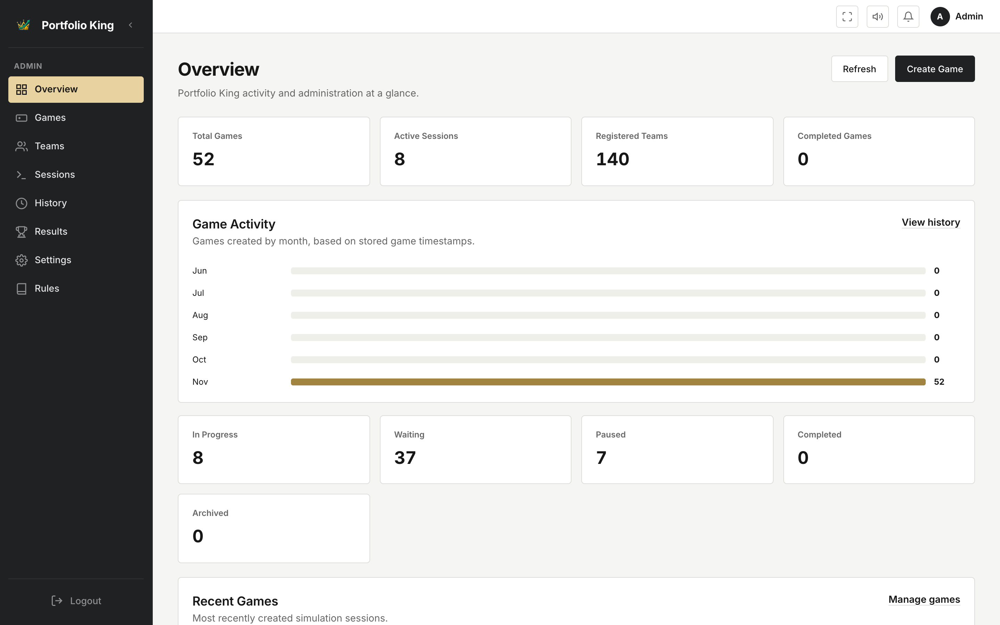
  <p><sub><em>Executive Overview Dashboard — session telemetry, active cohorts, and tournament controls.</em></sub></p>
</div>

<br/>

### Authentication & Access Control

<table width="100%">
  <tr>
    <td width="50%" align="center" valign="top">
      <strong>Team Login Terminal</strong><br/>
      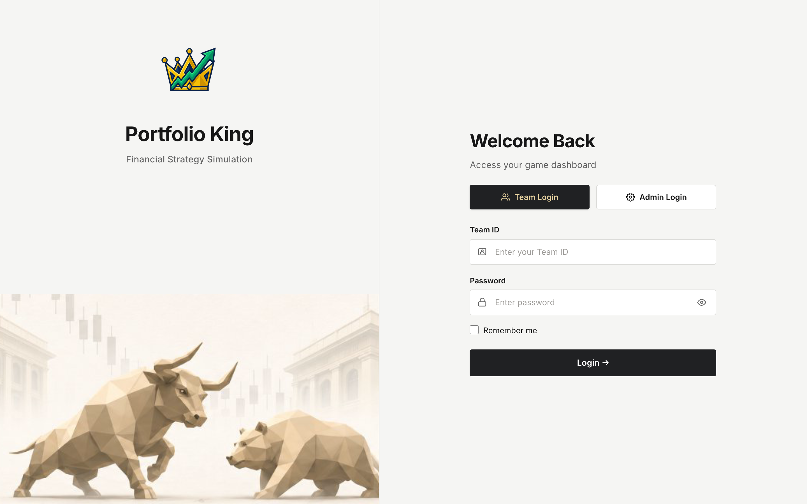<br/>
      <sub>Branded split authentication with market illustration</sub>
    </td>
    <td width="50%" align="center" valign="top">
      <strong>Administrator Login Terminal</strong><br/>
      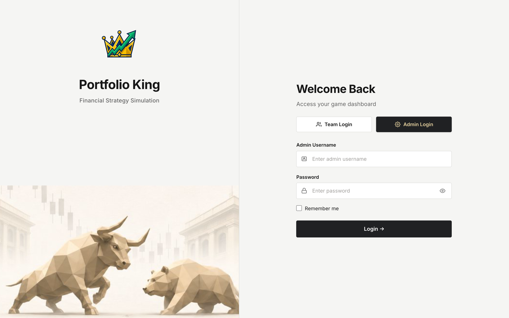<br/>
      <sub>Segmented credential validation with rate limiting</sub>
    </td>
  </tr>
</table>

### Executive Administration Suite

<table width="100%">
  <tr>
    <td width="50%" align="center" valign="top">
      <strong>Game Session Management</strong><br/>
      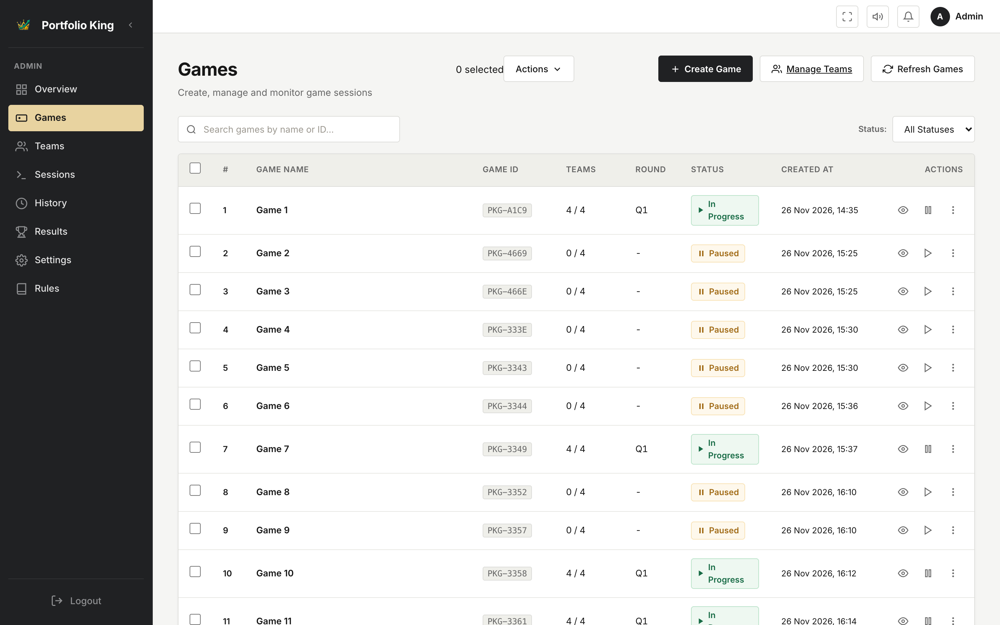<br/>
      <sub>Session provisioning, inline renaming, and bulk operations</sub>
    </td>
    <td width="50%" align="center" valign="top">
      <strong>Team Roster &amp; Credentials</strong><br/>
      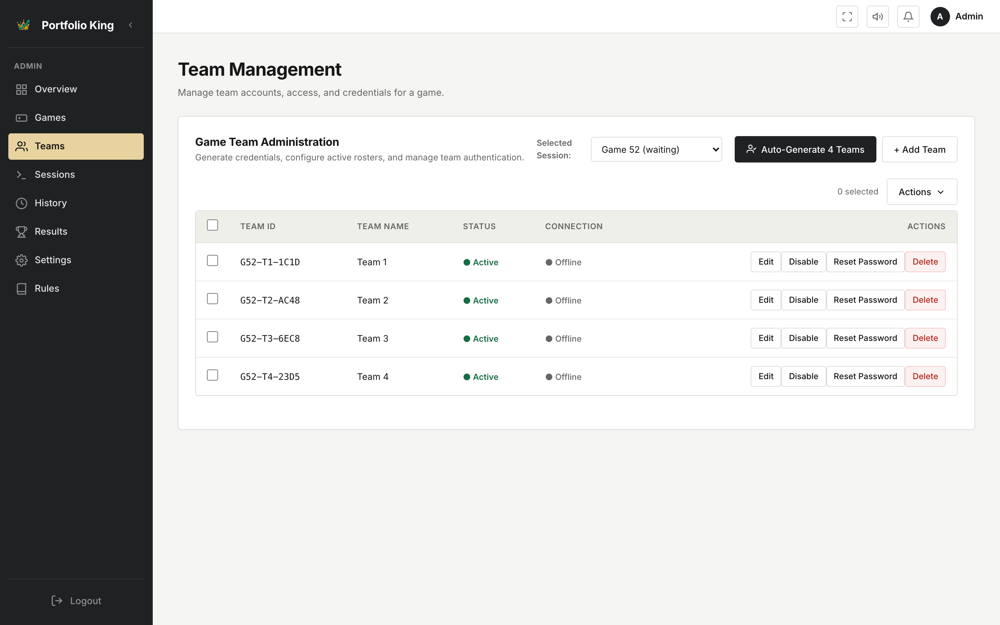<br/>
      <sub>Auto-generate 4-team rosters, export credentials, and status toggles</sub>
    </td>
  </tr>
  <tr>
    <td width="50%" align="center" valign="top">
      <strong>Live Sessions Monitor</strong><br/>
      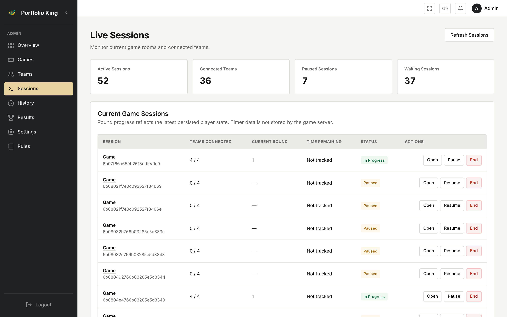<br/>
      <sub>Real-time multiplayer session telemetry and socket connectivity</sub>
    </td>
    <td width="50%" align="center" valign="top">
      <strong>Game History &amp; Archives</strong><br/>
      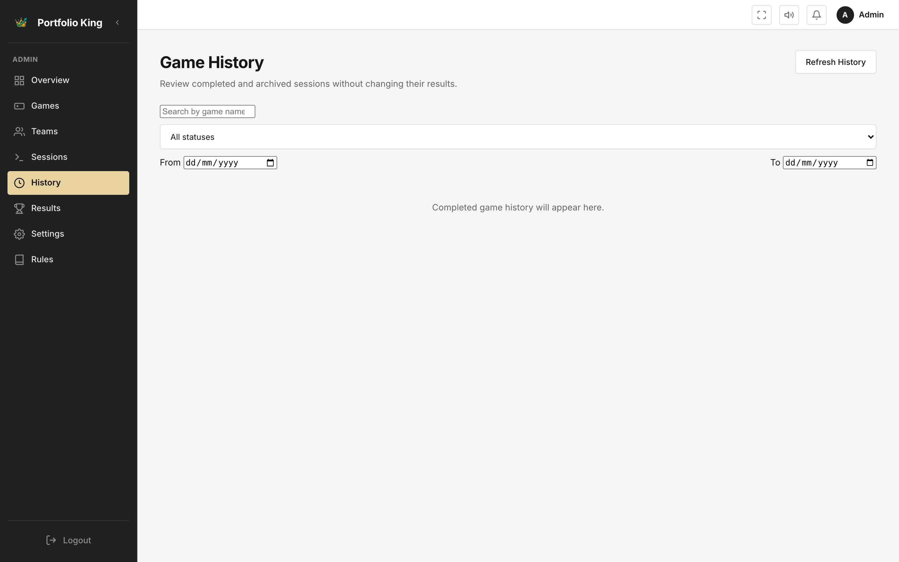<br/>
      <sub>Searchable audit trail of completed tournaments and historical rosters</sub>
    </td>
  </tr>
  <tr>
    <td width="50%" align="center" valign="top">
      <strong>Tournament Results &amp; Analytics</strong><br/>
      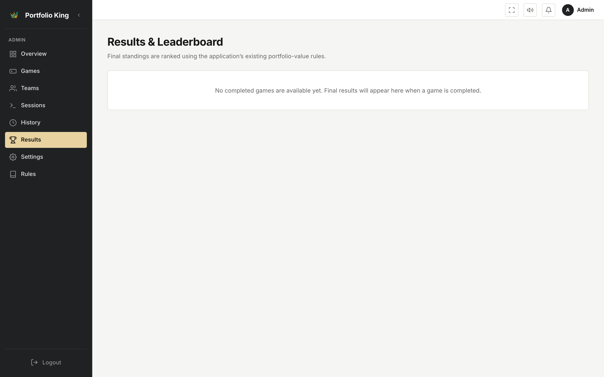<br/>
      <sub>Final syndicate standings, net worth rankings, and CSV export</sub>
    </td>
    <td width="50%" align="center" valign="top">
      <strong>System &amp; Simulation Settings</strong><br/>
      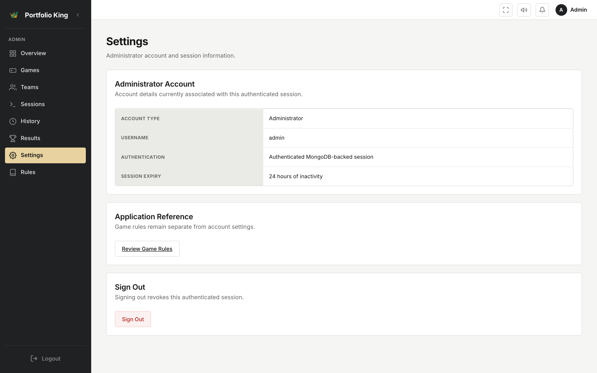<br/>
      <sub>Configurable macroeconomic parameters and environment telemetry</sub>
    </td>
  </tr>
</table>

### Syndicate Player Interface

<table width="100%">
  <tr>
    <td width="50%" align="center" valign="top">
      <strong>Pre-Game Waiting Room</strong><br/>
      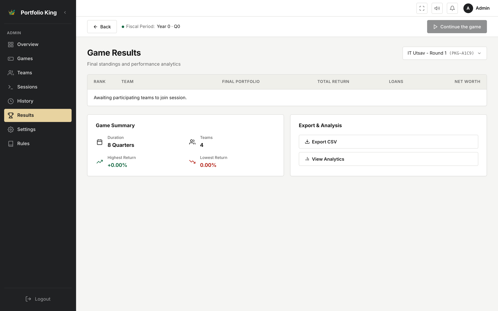<br/>
      <sub>Connected cohort verification and session readiness countdown</sub>
    </td>
    <td width="50%" align="center" valign="top">
      <strong>Portfolio Investment Terminal</strong><br/>
      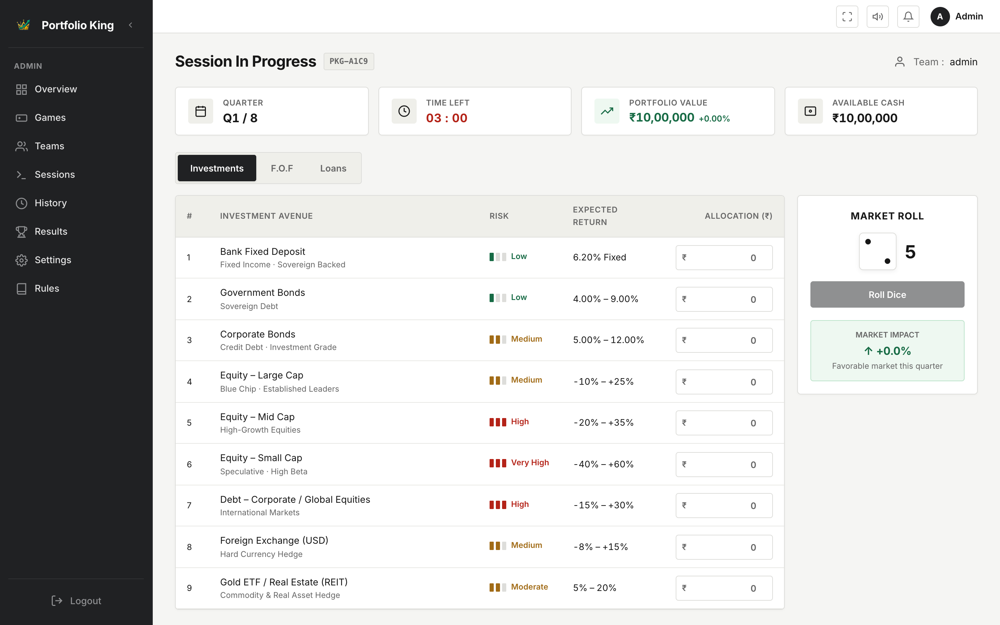<br/>
      <sub>Quarterly capital allocation across asset classes, FOF, and loans</sub>
    </td>
  </tr>
  <tr>
    <td width="50%" align="center" valign="top">
      <strong>Multiplayer Trading Board</strong><br/>
      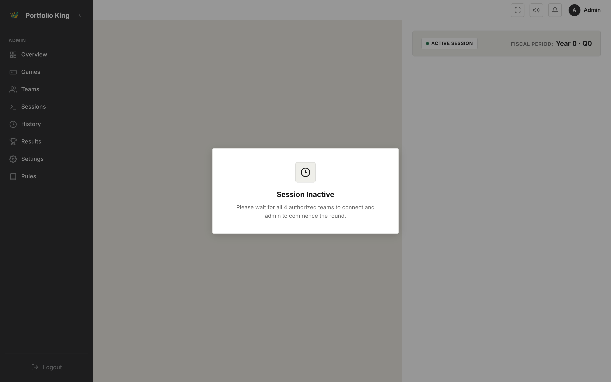<br/>
      <sub>Synchronized turn progression, dice roll outcomes, and market impact</sub>
    </td>
    <td width="50%" align="center" valign="top">
      <strong>Final Leaderboard &amp; Standings</strong><br/>
      <br/>
      <sub>Final valuation metrics, ROI comparisons, and podium results</sub>
    </td>
  </tr>
</table>

### Responsive Mobile Interface

<table width="100%">
  <tr>
    <td width="33.33%" align="center" valign="top">
      <strong>Mobile Authentication</strong><br/>
      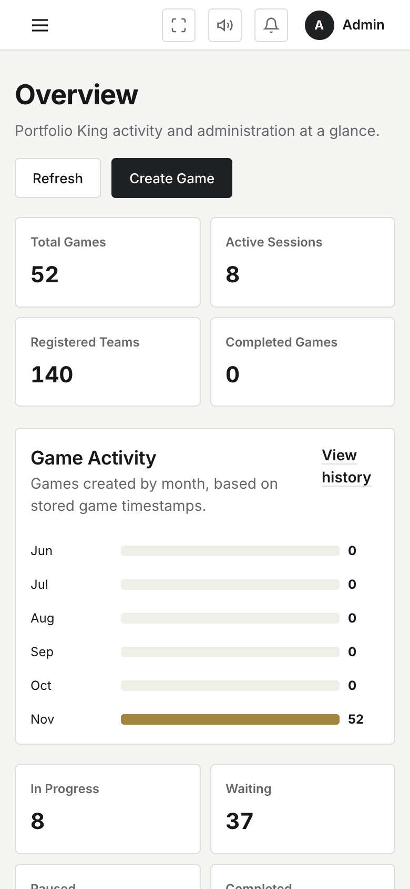<br/>
      <sub>Adaptive split authentication view</sub>
    </td>
    <td width="33.33%" align="center" valign="top">
      <strong>Mobile Administration</strong><br/>
      <br/>
      <sub>Touch-optimized tournament controls</sub>
    </td>
    <td width="33.33%" align="center" valign="top">
      <strong>Mobile Trading Terminal</strong><br/>
      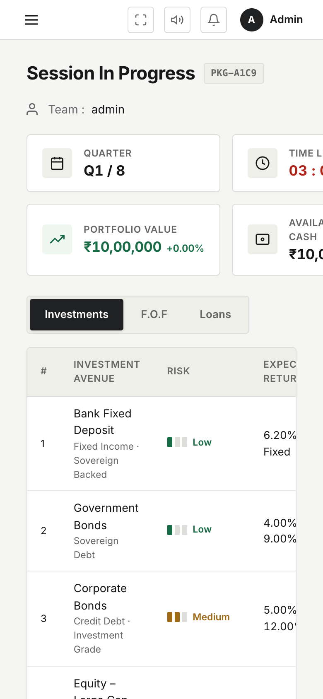<br/>
      <sub>Streamlined portfolio allocations</sub>
    </td>
  </tr>
</table>

---

<a id="features"></a>
##  Key Features

<table>
<tr>
<td width="50%" valign="top">

 **Real-Time Multiplayer Gameplay**
- WebSocket-powered state synchronization across up to 4 concurrent teams.
- Shared turn-based round progression and dynamic dice rolls.
- Live market condition changes and portfolio valuation updates.
- Automatic disconnection detection and seamless session reconnection.

 **Complete Administration Suite**
- Create, duplicate, rename, archive, and delete game sessions.
- Auto-generate secure 4-team credential packages with single-click copy.
- Real-time session monitoring with active participant counts.
- Single and bulk game deletion with modal confirmations.
- Team account enable/disable toggles with instant socket revocation.
- Full tournament results with CSV export capability.

 **Hardened Security Architecture**
- Asynchronous PBKDF2-HMAC-SHA256 password hashing (600,000 iterations).
- Cryptographically random per-user salts.
- Constant-time hash verification to defeat timing attacks.
- Server-side role authorization guards on all REST endpoints and socket events.
- Duplicate active session prevention (HTTP 409 Conflict rejection).
- Production credential checks that halt startup on default passwords.

</td>
<td width="50%" valign="top">

 **Portfolio Investment Engine**
- Six core asset classes: Equity (Large/Mid/Small Cap), Corporate Debt, Gold, Real Estate.
- Fund of Funds (FOF) option with 2% management fee structure.
- Debt and loan management with Excel-compatible EMI amortization.
- Baseline 6.2% Bank Fixed Deposit comparison floor.
- Dynamic dice roll mechanics (1–6) modifying asset yields each round.

 **Responsive Institutional UI**
- Warm ivory (`#F5F5F3`) and charcoal (`#202123`) institutional color tokens.
- Zero horizontal overflow across all viewports (320px mobile to 1920px desktop).
- Modern SVG technology iconography and consistent design tokens.
- Lottie loading animation with a 3-second hard maximum duration.

 **Modern Angular 22 Toolchain**
- Direct Angular 22 + TypeScript 6 migration.
- Ultra-fast esbuild application pipeline (`ng build` in ~5 seconds).
- Zero vulnerabilities across root, frontend, and backend packages.
- Zero reliance on `--openssl-legacy-provider`.

</td>
</tr>
</table>

---

<a id="tech-stack"></a>
##  Technology Stack

<div align="center">

<table>
  <tr>
    <td align="center" width="16%">
      <br/>
      <sub><b>Angular</b></sub>
    </td>
    <td align="center" width="16%">
      <br/>
      <sub><b>TypeScript</b></sub>
    </td>
    <td align="center" width="16%">
      <br/>
      <sub><b>Node.js</b></sub>
    </td>
    <td align="center" width="16%">
      <br/>
      <sub><b>MongoDB</b></sub>
    </td>
    <td align="center" width="16%">
      <br/>
      <sub><b>Socket.IO</b></sub>
    </td>
    <td align="center" width="16%">
      <br/>
      <sub><b>Git</b></sub>
    </td>
  </tr>
</table>

</div>

<br/>

<table>
  <thead>
    <tr>
      <th>Layer</th>
      <th>Technologies</th>
      <th>Version</th>
      <th>Role</th>
    </tr>
  </thead>
  <tbody>
    <tr>
      <td align="center"><strong>Frontend</strong></td>
      <td>
         <strong>Angular</strong><br/>
         <strong>TypeScript</strong><br/>
         <strong>HTML5</strong><br/>
         <strong>SCSS</strong><br/>
         <strong>Lottie</strong>
      </td>
      <td>
        <code>^22.3.0</code><br/>
        <code>~6.0.2</code><br/>
        <code>Standard</code><br/>
        <code>Dart Sass</code><br/>
        <code>^5.12.2</code>
      </td>
      <td>
        Component-based single page application, reactive forms, RxJS state management, design tokens, and vector loading animations.
      </td>
    </tr>
    <tr>
      <td align="center"><strong>Backend</strong></td>
      <td>
         <strong>Node.js</strong><br/>
         <strong>Express.js</strong><br/>
         <strong>JavaScript</strong>
      </td>
      <td>
        <code>^26.0.0</code> (LTS 26 Lithium)<br/>
        <code>^4.22.1</code><br/>
        <code>ES2022</code>
      </td>
      <td>
        RESTful API server, authenticated session management, Excel financial calculation engine, and static Angular SPA hosting.
      </td>
    </tr>
    <tr>
      <td align="center"><strong>Real-Time</strong></td>
      <td>
         <strong>Socket.IO</strong>
      </td>
      <td><code>^4.8.1</code> (Client &amp; Server)</td>
      <td>Bidirectional WebSocket engine synchronizing multi-client game states, turn broadcasts, and room telemetry.</td>
    </tr>
    <tr>
      <td align="center"><strong>Database</strong></td>
      <td>
         <strong>MongoDB</strong>
      </td>
      <td><code>^3.7.4</code> (Atlas / Community)</td>
      <td>Document store for game sessions, team credentials, historical rounds, and persistent authentication states.</td>
    </tr>
    <tr>
      <td align="center"><strong>Dev &amp; Deploy</strong></td>
      <td>
         <strong>npm</strong><br/>
         <strong>Git</strong><br/>
         <strong>Render</strong>
      </td>
      <td>
        <code>&gt;=10.0.0</code><br/>
        <code>Latest</code><br/>
        <code>Cloud Web Service</code>
      </td>
      <td>Dependency resolution, multi-workspace builds, version control, and production automated CI/CD hosting.</td>
    </tr>
  </tbody>
</table>

---

<a id="architecture"></a>
##  System Architecture

<div align="center">
  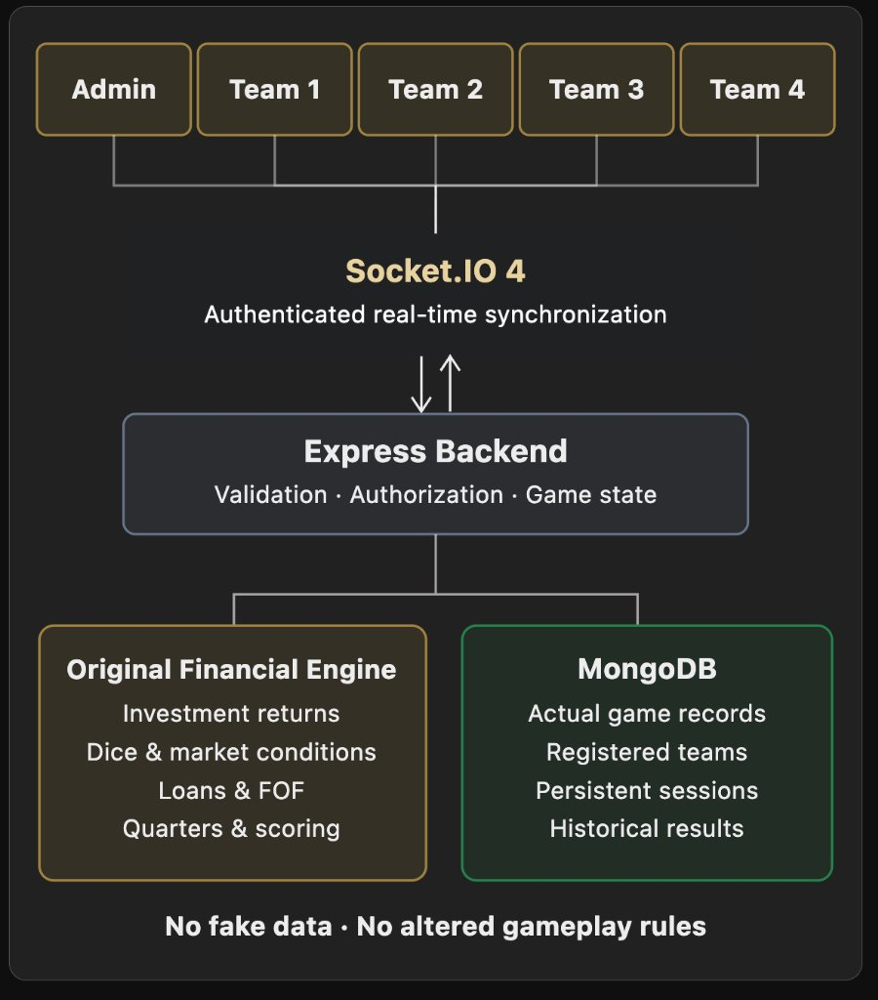
  <p><sub><em>Real-time multiplayer synchronization and authoritative financial engine architecture.</em></sub></p>
</div>

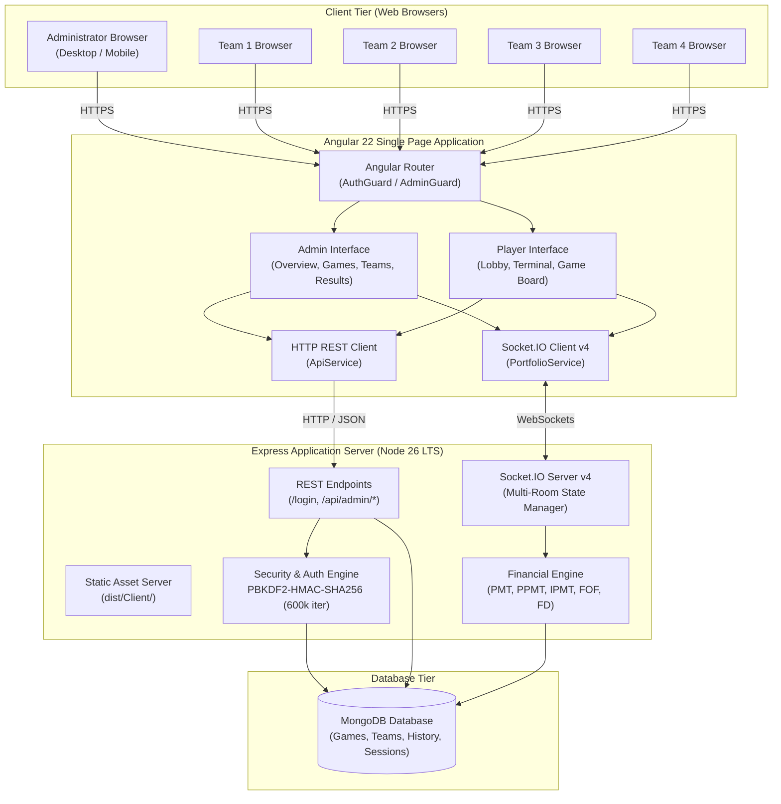

**Architecture Highlights:**
- **Single-Origin Deployment:** Express serves the compiled Angular 22 production bundle directly from `dist/Client`, eliminating CORS overhead in production.
- **Synchronized State Engine:** Socket.IO v4 maintains isolated rooms (`game-<id>`), multicasting dice outcomes and allocation updates to all verified teams.
- **Server-Side Financial Authority:** Client interfaces never calculate investment settlement figures directly; all yields, EMIs, and net worth calculations are performed on the server.

---

##  How Portfolio King Works

The simulation executes through an eight-stage lifecycle across two complete macroeconomic cycles (8 fiscal quarters):

```
Session Creation ──▶ Credential Distribution ──▶ Syndicate Authentication ──▶ Capital Allocation
                                                                                      │
Winner Crowned   ◀── Terminal Settlement    ◀── Multi-Quarter Cycle     ◀── Macro Dice Roll
```

1. **Session Provisioning:** The administrator creates a new game session in the executive dashboard.
2. **Credential Issuance:** The administrator triggers the *Auto-Generate 4 Teams* action, producing unique alphanumeric Team IDs and cryptographically random passwords.
3. **Syndicate Authentication:** Up to four teams log in from their respective devices. Duplicate logins are rejected with HTTP 409 Conflict.
4. **Capital Allocation:** Teams enter the investment terminal with ₹10,00,000 starting cash. They allocate capital across equities, debt, gold, real estate, bank deposits, and optional Fund of Funds (FOF).
5. **Macroeconomic Volatility:** A 30-second decision timer runs each round. Teams roll dice (outcomes 1–6) that trigger macroeconomic modifiers altering quarter returns.
6. **Automated Settlement:** The financial engine computes asset returns, applies the 2% FOF management fee, deducts loan EMIs (PMT/PPMT/IPMT), and updates net worth.
7. **Quarterly Progression:** The simulation advances through 8 fiscal quarters (Year 1: Q1–Q4, Year 2: Q1–Q4).
8. **Terminal Settlement & Winner:** Final standings are generated on the leaderboard, ranked by total portfolio net worth, and exported to CSV.

---

<a id="installation"></a>
<a id="getting-started"></a>
##  Getting Started

### Prerequisites

- **Node.js** `^26.0.0` (LTS 26 Lithium `v26.13.1` or `^24.15.0`)
- **npm** `≥ 10.0.0`
- **Git**
- **MongoDB** — local instance (`mongod`) or a [MongoDB Atlas](https://www.mongodb.com/atlas) cluster

### Installation

```bash
# 1. Clone the repository
git clone https://github.com/dr5t/Portfolio-King.git
cd Portfolio-King

# 2. Build the entire application (installs root, server, and frontend dependencies)
npm run build
```

> **Note:** `npm run build` runs an automated chained install across root, server, and frontend packages, then compiles the production Angular bundle into `portfolio-king/dist/Client/`.

### Environment Setup

Create a `.env` file in `portfolio-king-server/` (or copy `.env.example`):

```bash
cp .env.example portfolio-king-server/.env
```

Edit `portfolio-king-server/.env` with your preferred configuration:

```env
PORT=3000
HOST=0.0.0.0
MONGODB_URI=mongodb://127.0.0.1:27017/portfolio
DB_NAME=portfolio
ADMIN_USERNAME=admin
ADMIN_PASSWORD=your_secure_password_here
```

### Running the Application

```bash
# Production mode (serves compiled Angular bundle from Express)
npm start

# Application available at:
# http://localhost:3000
```

### Development Mode

For active frontend development with live watch compilation, run the Angular builder from a separate terminal:

```bash
cd portfolio-king
npm run watch
```

---

##  Environment Configuration

The application is configured via environment variables read at startup by `portfolio-king-server/index.js`:

| Variable | Description | Required | Safe Default / Example |
| :--- | :--- | :---: | :--- |
| `PORT` | HTTP port the server listens on | Optional | `3000` |
| `HOST` | Network interface address to bind | Optional | `0.0.0.0` |
| `MONGODB_URI` | MongoDB connection URI string | **Yes** | `mongodb://127.0.0.1:27017/portfolio` |
| `DB_NAME` | Target database collection name | Optional | `portfolio` |
| `ADMIN_USERNAME` | Master administrator username | **Yes** | `admin` |
| `ADMIN_PASSWORD` | Master administrator password | **Yes** | `DemoPass@2026` |
| `NODE_ENV` | Runtime environment mode | Optional | `production` / `development` |

> [!IMPORTANT]
> The server enforces a security startup guard: if `ADMIN_PASSWORD` is left as `admin`, the server will refuse to start in production to prevent default credential exploitation.

---

##  Project Structure

```
Portfolio-King/
├── package.json                    # Root build and startup orchestration scripts
├── render.yaml                     # Render infrastructure-as-code deployment config
├── .env.example                    # Safe template for environment configuration
│
├── docs/                           # Documentation assets
│   ├── logo.svg                    # Brand crown vector logo
│   ├── logo-transparent.png        # Transparent PNG brand asset
│   ├── assets/
│   │   └── icons/                  # High-contrast documentation section and tech icons
│   └── screenshots/                # Application screenshots (desktop 1440x900, mobile 390x844)
│
├── portfolio-king/                 # Angular 22 Single Page Application
│   ├── angular.json                # Angular 22 esbuild application configuration
│   ├── tsconfig.json               # Modern TypeScript 6 compiler configuration
│   ├── package.json                # Frontend dependencies (@angular/*, rxjs, socket.io-client)
│   └── src/
│       ├── app/
│       │   ├── admin/              # Admin overview, sessions, history, results, settings
│       │   ├── game/               # Multiplayer trading board and dice interaction
│       │   ├── game-status/        # Pre-game lobby and round status components
│       │   ├── home/               # Executive games dashboard and team manager
│       │   ├── investment-avenue/  # Portfolio allocation, FOF, and loan terminal
│       │   ├── login/              # Segmented team and admin authentication
│       │   ├── rules/              # Simulation tournament rulebook and guidelines
│       │   └── services/           # ApiService, PortfolioService, AuthGuard, AdminGuard
│       ├── assets/                 # Brand illustrations, fonts, and loading-animation.json
│       ├── styles.scss             # Design system variables, tokens, and utility styles
│       └── polyfills.ts            # Zone.js modern polyfill loader
│
└── portfolio-king-server/          # Node.js Express REST & WebSocket Server
    ├── index.js                    # Server bootstrap, static SPA router, socket binding
    ├── auth.js                     # PBKDF2-HMAC-SHA256 password hashing and verification
    ├── socket.js                   # Real-time WebSocket game event orchestration
    ├── routes/
    │   └── admin.js                # Authenticated administrative REST endpoints
    ├── formulas/
    │   └── financial.js            # PMT, PPMT, IPMT amortization and portfolio logic
    └── db/
        └── portfolio_db.js         # MongoDB connection lifecycle and schema operations
```

---

##  Production Deployment

Portfolio King is configured for single-click deployment on **Render** using the included [render.yaml](file:///Users/shauryatiwari/Portfolio%20king/render.yaml) blueprint.

**Live Application:** [https://portfolio-king-043i.onrender.com/login](https://portfolio-king-043i.onrender.com/login)

### Render Deployment Steps

1. **Connect Repository:** Link your GitHub repository `https://github.com/dr5t/Portfolio-King` on the Render Dashboard.
2. **Select Blueprint:** Render will automatically detect `render.yaml`.
3. **Configure Environment Variables:**
   - `NODE_VERSION`: `26.13.1`
   - `MONGODB_URI`: Your MongoDB Atlas connection string (e.g., `mongodb+srv://<username>:<password>@<cluster-host>/portfolio?retryWrites=true&w=majority`).
   - `ADMIN_USERNAME`: Master administrator username.
   - `ADMIN_PASSWORD`: High-entropy master administrator password.
4. **Deploy:** Render will trigger the build pipeline:
   - **Build Command:** `npm run build`
   - **Start Command:** `npm start`
5. **Atlas Network Access:** Ensure your MongoDB Atlas Network Access whitelist includes `0.0.0.0/0` (allow access from anywhere) so Render cloud instances can reach the database.

> [!NOTE]
> If deployed on a Render Free instance, the service will spin down after inactivity. Initial cold-start requests may take 30–50 seconds to resume.

---

##  Security Architecture

The application has been audited and hardened against common web application vulnerabilities:

- **Password Hashing:** Asynchronous `crypto.pbkdf2` using HMAC-SHA256 with **600,000 iterations** and 32-byte cryptographically secure salts.
- **Timing Attack Resistance:** Password comparisons utilize `crypto.timingSafeEqual` to eliminate timing discrepancies during credential verification.
- **Session Integrity & Anti-Duplicate:** Active team sessions maintain socket ID bindings in MongoDB. Concurrent login attempts from separate browsers with the same Team ID are rejected with `409 Conflict`.
- **Role-Based Route Authorization:** All administrative REST endpoints verify `isAdmin === 'true'` server-side. Unauthenticated requests are rejected with `401 Unauthorized` or `403 Forbidden`.
- **Injection Defenses:** 
  - MongoDB queries utilize strict parameter mapping to prevent NoSQL query object injection.
  - CSV report exports sanitize leading formula characters (`=`, `+`, `-`, `@`) to prevent CSV injection in spreadsheet applications.
  - Content Security Policy (CSP) headers restrict script execution and style sources.

---

##  Testing & Verification

Comprehensive automated test suites are provided to verify system integrity:

```bash
# 1. Run Financial Engine Regression Suite (PMT, PPMT, IPMT, 2% FOF, 6.2% Bank FD)
node scratch/test-financial-calculations.js

# 2. Run Authentication & Security Audit Suite (12 test vectors)
node scratch/test-auth-system.js

# 3. Run Lottie Loading Animation Integration Suite
node scratch/test-loader-lottie.js

# 4. Run 10-Viewport Responsiveness & Layout Suite (320px to 1920px)
node scratch/test-viewports-responsiveness.js

# 5. Run Full 4-Team Multiplayer End-to-End Suite
node scratch/run-e2e-auth-multiplayer.js
```

---

##  Troubleshooting

### MongoDB Connection Refused (`ECONNREFUSED 127.0.0.1:27017`)
- Ensure local MongoDB is running: `brew services start mongodb-community` (macOS) or `sudo systemctl start mongod` (Linux).
- If using MongoDB Atlas, verify your IP is whitelisted in Network Access and `MONGODB_URI` contains the correct user credentials.

### Port Already in Use (`EADDRINUSE :::3000`)
- Another process is occupying port 3000. Identify and terminate it:
  ```bash
  lsof -i :3000
  kill -9 <PID>
  ```

### Node.js Engine Warning
- Ensure you are running Node.js `^26.0.0` (or `^24.15.0`). Check your version:
  ```bash
  node -v
  ```
  Switch to a supported LTS version via nvm: `nvm use 26`.

### Duplicate Session Alert (`Team already connected`)
- A team account is currently engaged in an active game session. The administrator can disable and re-enable the team from the *Team Management* tab to force a session reset.

---

##  License & Attribution

### Original Project Attribution
- **Creator & Author:** Shaurya Tiwari ([@dr5t](https://github.com/dr5t))
- **Repository:** [dr5t/Portfolio-King](https://github.com/dr5t/Portfolio-King)

### Source-Available Proprietary License
Portfolio King is publicly available for technical inspection, educational evaluation, and demonstration purposes. Public accessibility does **not** grant unrestricted permission to reuse, copy, redistribute, adapt, or commercially exploit this software.

- **Protected Materials:** All original contributions, modern architectures, responsive interfaces, custom UI/UX design, administrative tools, security mechanisms, visual branding, and documentation authored by Shaurya Tiwari (@dr5t) are protected under the **Portfolio King — Source-Available Proprietary License** (all rights reserved). Prior written authorization is required for copying, redistribution, adaptation, or commercial use beyond permitted evaluation activities.
- **Unauthorized Use:** Unauthorized reproduction, redistribution, adaptation, commercial exploitation, or misrepresentation of copyrighted materials covered by this license may constitute copyright infringement. The copyright holder reserves the right to pursue available legal remedies, including applicable copyright takedown procedures, where infringement is established.
- **Third-Party & Predecessor Code:** Open-source third-party dependencies (e.g., Angular, Express, Socket.IO, MongoDB Node.js driver, Lottie-web, jQuery) and code portions originally released under the ISC license remain governed by their respective licenses.

For full legal terms and conditions, refer to the root [LICENSE](LICENSE) file. For permissions and inquiries, visit [https://github.com/dr5t](https://github.com/dr5t).

### Third-Party Assets & Libraries
- **Frameworks & Libraries:** Angular (MIT), Express (MIT), Socket.IO (MIT), MongoDB Node.js Driver (Apache 2.0), RxJS (Apache 2.0), jQuery (MIT).
- **Technology Logos:** Simple Icons, Devicon, and respective trademark owners.
- **Vector Icons:** Lucide Icons.
- **Loader Animation:** LottieFiles.

---

<div align="center">


**Portfolio King**

[Live Application](https://portfolio-king-043i.onrender.com/login) · [GitHub Repository](https://github.com/dr5t/Portfolio-King) · [Back to Top](#portfolio-king)

</div>
